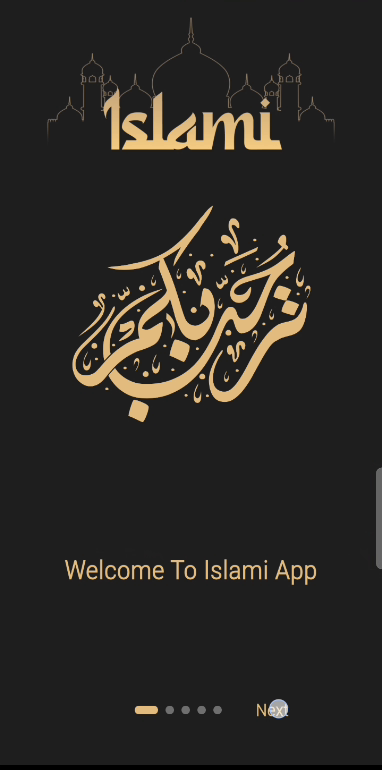
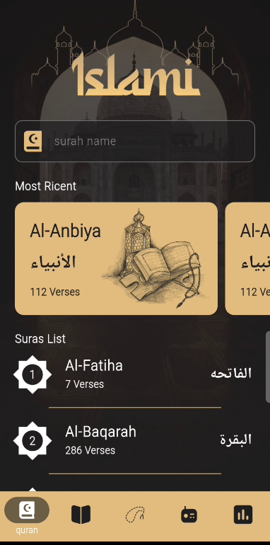
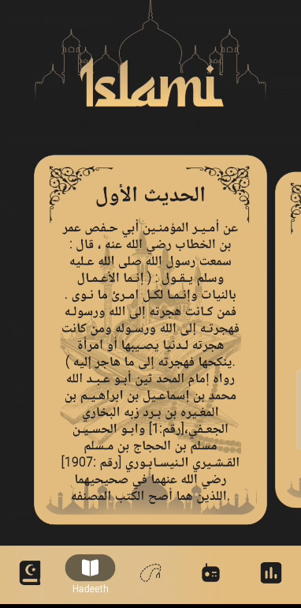
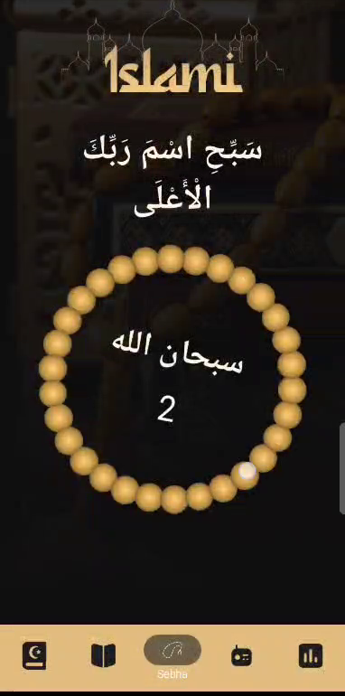
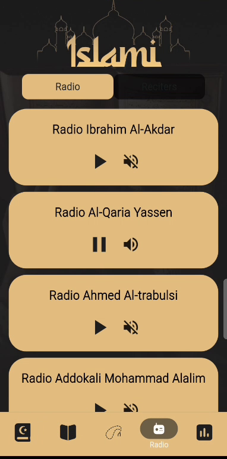
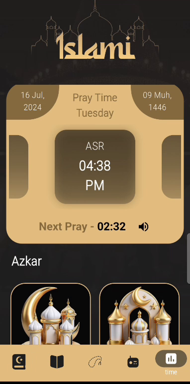

 🕌 Islami App (Flutter)

A Flutter Islamic application that brings essential daily features together in one place: Quran, Hadith, Sebha, Quran Radio, and prayer times, with a clean dark and gold design.

 📸 Screenshots

  
  

 ✨ Features
- 🌟 Splash screen and onboarding flow
- 📖 **Quran:** all surahs with English and Arabic names and verse count, search by surah name, and a "Most Recent" section
- 📜 **Hadith:** browse hadiths in swipeable cards
- 📿 **Sebha:** digital tasbeeh counter
- 📻 **Radio:** listen to Holy Quran radio stations
- ⏰ **Time:** prayer times, next prayer countdown, and Azkar
- Bottom navigation between the 5 sections

 🧩 Tech Stack
- Flutter & Dart

 🚀 Getting Started
Project source is in the `islamy` folder.

    cd islamy
    flutter pub get
    flutter run
